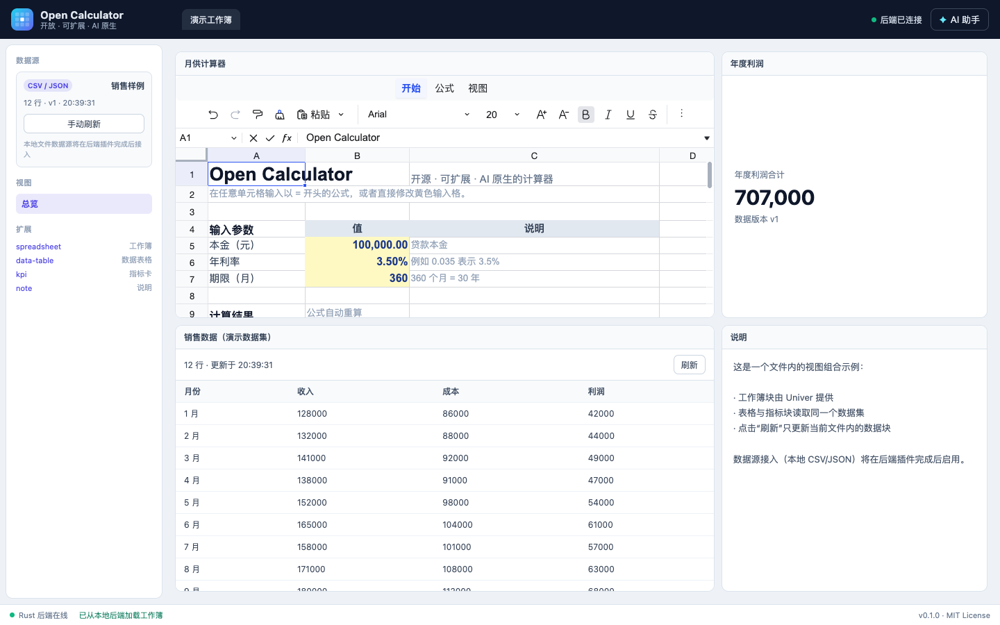

# Open Calculator

> 开放、可扩展、AI 原生的计算器 —— 以类 Excel 网格为统一交互界面，Web 技术 + Rust 后端，前后分离，可打包为桌面应用。



## 这是什么

Open Calculator 不是传统意义上的“一个计算器页面”，而是一个**可组合的计算工作台**：

- **像 Excel**：单元格、公式栏、多工作表、数字格式、自动重算，学习成本接近零。
- **开放**：代码 MIT，公式引擎与插件机制基于开源生态（Univer / Rust）。
- **可扩展**：文件内视图由可组合的块构成，内置块与第三方块使用同一套扩展注册 API。
- **AI 原生**：AI 是表格的“操作者”——自然语言生成公式、解释结果、生成计算模型（当前为设计阶段，见路线图）。
- **本地优先**：计算与数据默认留在本机；Rust 后端可代理模型密钥，也可接本地 Ollama。

## 仓库结构（前后端分离）

```text
open-calculator/
├── frontend/                 # 前端区域（独立 pnpm workspace）
│   ├── apps/web/             # React + Vite + Univer 应用
│   ├── apps/desktop/         # Tauri 2 桌面壳（src-tauri/）
│   ├── packages/             # 可独立测试的前端包
│   │   ├── contracts/        # 纯类型与契约
│   │   ├── api-client/       # 类型化 HTTP 客户端
│   │   ├── workbook-univer/  # Univer 适配层（重依赖隔离）
│   │   ├── extensions/       # 扩展注册表与 React 槽位
│   │   ├── composition/      # 视图与块宿主
│   │   └── blocks/           # 内置块（工作簿/表格/KPI/说明）
│   ├── package.json
│   ├── pnpm-workspace.yaml
│   └── eslint.config.js      # 含 boundaries 强制包边界
├── backend/                  # 后端区域（独立 Cargo workspace）
│   ├── crates/server/        # Axum 服务（open-calculator-server）
│   ├── Cargo.toml
│   └── rust-toolchain.toml
├── scripts/                  # 根级编排：dev / build / check / build-desktop
├── docs/                     # 架构、ADR、路线图
├── .github/workflows/ci.yml
└── README.md
```

- 前后端各有自己的依赖与构建入口，互不混杂；
- 根目录只保留文档与编排脚本，不承载任何一端的源码或工具链配置。

## 当前状态

| 能力                                           | 状态                                        |
| ---------------------------------------------- | ------------------------------------------- |
| 类 Excel 表格（公式 / 格式 / 多工作表）        | ✅ Univer 1.5.2                             |
| 单文件内视图组合（工作簿 / 表格 / KPI / 说明） | ✅ 扩展注册 + 懒加载块 + 布局               |
| 内置块刷新后的响应式更新                       | ✅ 数据版本通知，表格与 KPI 同步            |
| 工作簿自动保存 / 加载                          | ✅ 前端 → Rust 后端（内存存储，重启后重置） |
| Rust HTTP API（health / meta / workbooks）     | ✅ Axum 0.8 + Tokio                         |
| Tauri 桌面壳（dev 加载 Web，release 内嵌后端） | ✅ 可打包 `.app`                            |
| AI 助手                                        | 🚧 面板与接口设计就绪，模型通道待接入       |
| 官方插件（CSV/JSON、公式函数）                 | 🚧 设计已定，待实现                         |
| 文件级持久化 / 崩溃恢复                        | 🚧 设计已定（原子写 + 检查点），待实现      |

## 技术栈

| 层       | 选型                                                             | 说明                                             |
| -------- | ---------------------------------------------------------------- | ------------------------------------------------ |
| 前端     | React 19 + TypeScript 5.9 + Vite 8                               | 应用外壳、视图组合、AI 面板                      |
| 表格引擎 | [Univer](https://univer.ai) 1.5.2（Apache-2.0）                  | Canvas 渲染的 Excel 兼容网格、公式引擎、插件体系 |
| 后端     | Rust 2024 + [Axum](https://github.com/tokio-rs/axum) 0.8 + Tokio | 本地 HTTP API、文件持久化/恢复、官方插件运行时   |
| 桌面     | [Tauri 2](https://tauri.app)                                     | 复用系统 WebView，Rust 侧内嵌后端 sidecar        |
| 工程     | pnpm workspace（frontend）+ Cargo workspace（backend）           | 两端独立依赖、构建与 CI                          |
| CI       | GitHub Actions                                                   | 前端 lint/test/build + 后端 fmt/clippy/test      |

更完整的选型对比与理由见 [docs/architecture/tech-stack.md](docs/architecture/tech-stack.md)。

> **工程原则**：性能、简洁、模块独立是硬约束，含可度量预算与模块依赖规则，见 [docs/architecture/principles.md](docs/architecture/principles.md)。
> 已决定保留 Univer（Excel 级体验优先）；性能预算按该路线校准。后端决策见 [docs/architecture/backend.md](docs/architecture/backend.md)，前端决策见 [docs/architecture/frontend.md](docs/architecture/frontend.md)。

## 快速开始

环境要求：Node.js ≥ 22.12、pnpm 12、Rust stable ≥ 1.85（本项目使用 1.100 验证）、macOS 需 Xcode Command Line Tools（Tauri 开发）。

```bash
# 首次安装前端依赖
pnpm --dir frontend install

# 一键启动前后端（http://localhost:5173 + http://127.0.0.1:8787）
./scripts/dev.sh
```

也可以分开启动：

```bash
# 终端 A：后端
cd backend && cargo run -p open-calculator-server

# 终端 B：前端
cd frontend && pnpm dev
```

打开 http://localhost:5173 即可看到“总览”视图：工作簿、KPI、数据表格与说明块；修改黄色输入格公式会即时重算，点击数据源的“手动刷新”会更新当前文件内的表格与指标。

```bash
# 构建（后端 release + 前端产物）
./scripts/build.sh

# 打包 Tauri 桌面应用（自动构建 sidecar 与前端）
./scripts/build-desktop.sh

# 全仓检查（后端 fmt/clippy/test + 前端 lint/test/build）
./scripts/check.sh
```

桌面开发：先 `./scripts/dev.sh`，再在另一个终端执行：

```bash
cd frontend && pnpm dev:desktop
```

## 架构一览

```text
┌──────────────────────────────────┐        ┌───────────────────────────────┐
│ frontend/ (React + Univer)        │  HTTP  │ backend/ (Axum, 127.0.0.1)    │
│ 应用外壳 / 视图块 / 扩展注册表     │◄──────►│ /api/v1/health · meta          │
│ 本地公式引擎（输入即算）           │  JSON  │ /api/v1/workbooks/{id}         │
└──────────────────────────────────┘        │ [规划] 持久化 / AI / 插件      │
                                             └───────────────────────────────┘
```

- **交互式计算**由 Univer 的 TypeScript 公式引擎在本地完成，保证输入即算、离线可用。
- **Rust 后端**负责数据持久化，以及未来的 AI 代理、自定义函数与插件执行。
- 详细分层见 [架构总览](docs/architecture/overview.md)。

## 文档

- [工程原则与性能预算](docs/architecture/principles.md)
- [后端架构设计](docs/architecture/backend.md)
- [前端架构设计](docs/architecture/frontend.md)
- [架构总览](docs/architecture/overview.md)
- [技术选型与对比](docs/architecture/tech-stack.md)
- [路线图](docs/roadmap.md)
- [架构决策记录（ADR）](docs/adr/)
- [贡献指南](CONTRIBUTING.md)

## License

[MIT](LICENSE) © Fu, Biye
