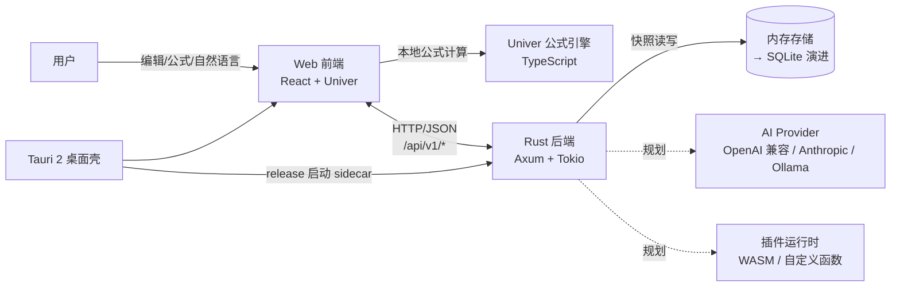
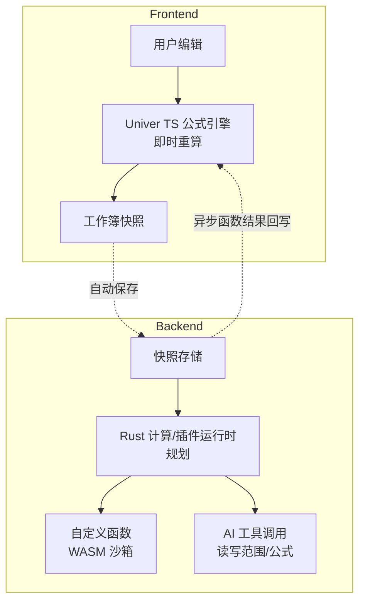

# 架构总览

- 状态：v0.1.0 骨架
- 最后更新：2026-11-21
- 相关文档：[工程原则与性能预算](principles.md) · [技术选型](tech-stack.md) · [ADR](../adr/)

## 1. 产品定位

Open Calculator 是一个**以电子表格为交互界面的可扩展计算器**。它要解决三类需求：

1. **随手算**：像计算器一样快，输入 `=` 公式立刻得到结果。
2. **算得清**：像 Excel 一样能建立多单元格、多工作表的计算模型（贷款、预算、单位换算、工程计算）。
3. **算得聪明**：AI 能把自然语言需求转成公式/模型，能解释结果，并在用户授权下修改表格。

“开放 / 可扩展”体现在两个层面：

- **能力可扩展**：自定义函数、数据源、AI 工具以插件形式接入，不需要 fork 核心。
- **产品可部署**：同一套 Web 前端可跑在浏览器，也可被 Tauri 打包成桌面应用；Rust 后端既可本地随应用启动，也可独立部署。

## 2. 系统上下文



当前代码中已经落地的部分：UI、本地公式计算、HTTP API、内存工作簿存储、自动保存、Tauri 骨架。虚线部分是路线图内容。

## 3. 代码组成

| 目录            | 职责                                                               | 关键依赖                       |
| --------------- | ------------------------------------------------------------------ | ------------------------------ |
| `apps/web`      | 应用外壳、表格界面、AI 面板、API 客户端                            | React 19、Vite 8、Univer 1.5.2 |
| `crates/server` | 本地 HTTP API、工作簿快照存储（当前内存）、CORS、tracing、优雅关闭 | Axum 0.8、Tokio、tower-http    |
| `apps/desktop`  | 桌面打包；dev 复用 Vite dev server，release 内嵌后端二进制         | Tauri 2、tauri-plugin-shell    |
| `docs`          | 架构、选型、ADR、路线图                                            | -                              |

未来新增（不在当前范围）：`crates/calc-engine`（Rust 计算/插件运行时）、`crates/ai`（模型网关）、`packages/sdk`（前端插件 SDK）。

## 4. 前后端协议

前后分离，所有交互通过 `http://127.0.0.1:8787/api/v1` 的 JSON API：

| 方法 | 路径              | 用途                                  |
| ---- | ----------------- | ------------------------------------- |
| GET  | `/health`         | 存活检查                              |
| GET  | `/meta`           | 产品版本、能力开关（`ai`、`plugins`） |
| GET  | `/workbooks/{id}` | 读取工作簿快照 + 修订号               |
| PUT  | `/workbooks/{id}` | Upsert 快照，修订号递增               |

约定：

- 错误统一为 `{"error":{"code": "...", "message": "..."}}`。
- 请求体上限 8 MiB；服务默认只监听 `127.0.0.1`。
- 开发期浏览器只访问 Vite（5173），由 Vite 把 `/api` 代理到 8787，避免 CORS；桌面发布版通过 `VITE_API_BASE_URL` 指向本地后端。
- 现在手写 TypeScript 类型；接口稳定后将用 OpenAPI 或 `ts-rs` 生成共享类型，避免漂移。

## 5. 计算引擎分层（关键设计）

“双引擎”是这类产品的核心难题：Univer 自带公式引擎能即时响应，但自定义函数、批量计算与 AI 工具需要 Rust 侧的权威能力。



分阶段策略（详见 [ADR-0005](../adr/0005-compute-layering.md)）：

1. **现在（v0.1）**：只使用 Univer TS 引擎。所有内置公式本地计算，后端口径无关。
2. **下一步（v0.2）**：Rust 侧引入自定义函数注册表与 WASM 沙箱（`wasmtime`）。前端通过 Univer 的自定义函数/RPC 机制调用后端，异步结果写回单元格；同时建立**公式口径一致性测试集**（同一批公式在两侧求值对比）。
3. **以后**：若 Excel 兼容性成为瓶颈，用 [`formualizer`](https://crates.io/crates/formualizer) 等 Rust 引擎承担服务端/批量/导出计算，并明确“权威引擎”与“交互引擎”的职责边界；导出 xlsx 时用 `umya-spreadsheet`。

明确不做的事：现在不追求“前后端公式 100% 一致”。先把边界定在“内置函数走本地、扩展函数走服务端”，用测试集约束，而不是另写一套完整引擎。

## 6. AI 层设计

目标形态：**AI 作为表格操作者**，而不是聊天窗口玩具。

```text
用户自然语言
   → 前端把「选区 + 工作表结构 + 需求」发给后端
   → 后端组装 prompt，调用模型（工具调用）
   → 模型输出受控工具：read_range / write_range / set_formula / explain_formula
   → 前端执行改动（可撤销），或后端返回公式建议
```

原则：

- **密钥不进前端**：模型 key 由后端持有（本地环境变量 / 系统钥匙串），前端拿不到。
- **权限最小化**：AI 只能读写用户显式授权的范围；写操作在 UI 中确认或进入 Undo 栈。
- **Provider 无关**：OpenAI 兼容协议（含 DeepSeek/OpenRouter 等）、Anthropic、Ollama 本地模型统一抽象。
- **流式输出**：后端用 SSE 向前端推 token 与工具调用事件。
- **可审计**：记录 AI 会话与改动（后续阶段）。

MVP 顺序：解释公式 → 生成公式 → 基于选区写值 → 生成整表模型 → 多轮对话。

## 7. 扩展模型

| 扩展类型             | 运行位置                 | 能力                                          | 阶段  |
| -------------------- | ------------------------ | --------------------------------------------- | ----- |
| 自定义函数（公式内） | Rust / WASM 沙箱         | `=MY_FN(...)`，可访问网络或本地数据需声明权限 | v0.2+ |
| AI 工具              | Rust                     | 读写表格、解释、生成                          | v0.2  |
| 前端 UI 插件         | 浏览器 / Univer 插件 API | 工具栏、侧边栏、渲染扩展                      | v0.3  |
| 数据源连接器         | Rust                     | HTTP/SQLite/CSV 读取为表格                    | v0.3  |

插件以 manifest 描述：`id`、版本、能力声明（`functions` / `tools` / `ui`）、权限、兼容的 app 版本。运行前校验签名与权限，缺省拒绝。详细草案见[技术选型文档 §7](tech-stack.md)。

## 8. 数据与持久化

- 当前：内存 `HashMap<String, Workbook>`，进程退出即丢失；仅用于打通链路。
- v0.2：SQLite（`sqlx`），表结构最小化为 `workbooks(id, name, snapshot_json, revision, updated_at)`，快照整体读写；后续再考虑增量/事件日志。
- 导入导出：xlsx 由 Rust（`umya-spreadsheet` / `calamine`）处理；Univer 也提供前端导入导出插件，二者择一作为权威路径（见路线图）。
- 非目标（当前）：多人协作、CRDT、云同步。Univer 具备协作能力，但产品暂不做多用户。

## 9. 部署形态

| 形态               | 前端                 | 后端                       | 备注                |
| ------------------ | -------------------- | -------------------------- | ------------------- |
| 浏览器 + 本地服务  | Vite dev / 静态托管  | `open-calculator-server`   | 开发与自托管        |
| 桌面（Tauri）      | 内嵌 `apps/web/dist` | 打包为 sidecar，随应用启动 | macOS/Windows/Linux |
| 单机可执行（规划） | 静态资源内嵌         | 同一进程提供静态文件 + API | 降低部署门槛        |

## 10. 质量与工程基线

- 性能预算、模块边界与接口规则以 [工程原则与性能预算](principles.md) 为准；每次交付须验证预算与依赖方向。
- 前端：ESLint 10 + TypeScript strict + Vitest；后续补 Playwright 端到端（含公式重算与保存流程）。
- 后端：`cargo fmt`、`clippy -D warnings`、集成测试（`tower::ServiceExt::oneshot`，不依赖端口）。
- CI：GitHub Actions 双 job（Web / Rust），PR 必须全绿。
- 提交：Conventional Commits；小步提交；每次交付同步更新文档。
